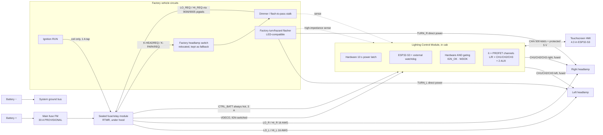
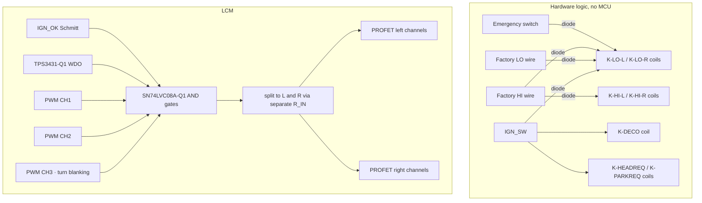

# Deliverable 1 – System Architecture (Rev A)

## 1.1 Design principles

1. **Criticality partitioning.** Every function belongs to one of three tiers, and no tier depends on a
   tier below it.

   | Tier | Functions | Implemented with | Depends on MCU? |
   |---|---|---|---|
   | **T1 – Essential** | Low beam, high beam, front turn/hazard | Relays, diodes, factory flasher, factory stalk | **No** |
   | **T2 – Decorative** | Honeycomb, DRL strip, amber running | LCM (PROFET switches + ESP32-S3) | Yes. Fails **OFF** |
   | **T3 – Interface** | Touchscreen, settings UI, diagnostics display | HMI (Waveshare ESP32-S3 4.3B) | Yes. Failure has no lighting effect |

2. **Hardware owns safety; software owns comfort.** Ignition-off cutoff, watchdog cutoff, the 10 s
   power-down, short-circuit protection and wire protection are all hardware. Firmware adds brightness,
   diagnostics and messaging.
3. **Non-destructive vehicle integration.** Connect to factory circuits with plug-in pigtails at
   existing connectors wherever possible, so the truck can be returned to stock.
4. **Serviceability.** Plug-in relays and fuses in one sealed module; sealed DT connectors at every
   module boundary; each headlamp detaches with two plugs.

## 1.2 System block diagram



## 1.3 Power flow

```
BATTERY (+)
  └─ FM  main fuse (≤ 300 mm from battery, PROVISIONAL 30 A, 10 AWG)
       └─ RTMR input bus
            ├─ F1 5 A ── K2 K-LO-L   ──► Left low-beam projector
            ├─ F2 5 A ── K3 K-LO-R   ──► Right low-beam projector
            ├─ F3 5 A ── K4 K-HI-L   ──► Left high-beam projector
            ├─ F4 5 A ── K5 K-HI-R   ──► Right high-beam projector
            ├─ F5 10 A ── K8 K-DECO   ──► LCM VDECO (decorative power, IGN-switched)
            ├─ F6 3 A  ─────────────── ──► LCM CTRL_BATT (always hot → hardware latch)
            ├─ F7 5 A  ── K1 K-IGN    ──► IGN_SW bus (relay coils + IGN sense)
            ├─ F8 5 A  ─────────────── ──► Emergency headlamp switch (guarded)
            ├─ F9 5 A  ── K6 K-HEADREQ ─► factory HEAD circuit (only if "feed" option, see 1.6)
            ├─ F10 (if used) K7 K-PARKREQ ► factory PARK circuit
            ├─ F11 AUX (future fans/accessories)
            └─ F12 spare
BATTERY (−) ── 10 AWG (P) ── SYSTEM GROUND BUS (stud next to RTMR)
            ├─ projector returns (one 16 AWG per projector)
            ├─ LCM power ground (14 AWG) and LCM logic ground (18 AWG), joined only on the LCM
            └─ relay coil returns
```

Factory circuits supply **no** lighting power to the new system. The only things the new system takes
from the truck are:

* about 150 mA of K-IGN coil current from an ignition-RUN tap, and
* the request voltages on the factory low/high headlamp wires, which now only drive relay coils.

The **front amber turn element** is the one deliberate exception. It is powered by the factory flasher
output, exactly as the factory front turn bulb was, so turn and hazard signals keep working even if
every custom component is dead.

## 1.4 Control flow



* **High beam keeps low beam lit:** the low-beam relay coils are diode-ORed from IGN_SW, LO_REQ
  **and HI_REQ**. A conventional dimmer stalk de-energizes the LO wire when HI is selected, but the
  low-beam relays stay energized.
* **Left/right synchronization:** one PWM signal per channel drives both sides' PROFET inputs, so L
  and R get the same duty from the same timer edge by construction.

## 1.5 Ignition behavior

| Event | Hardware response | Firmware response |
|---|---|---|
| Ignition → RUN | K-IGN closes → IGN_SW live → K-LO-L/R, K-DECO, K-HEADREQ, K-PARKREQ energize. Low beams **on within relay pull-in time** (no MCU involved). LCM latch switches on CTRL power. | LCM boots (outputs held off by pull-downs and gating), loads saved settings, waits 1 s blanking, then soft-starts decorative channels over 500 ms. HMI boots and requests status. |
| Cranking | If the chosen IGN circuit stays hot in CRANK (O-6), nothing changes. PROFETs operate down to 3.1 V. LCM 5 V buck runs to about 4.2 V input. | VBAT < 9.0 V for > 200 ms → decorative suspended (prevents brownout flicker and false faults); resumes with ramp when VBAT > 10.5 V for 500 ms. |
| Ignition → OFF | IGN_SW drops → all relays open → **projectors off immediately**. IGN_OK low → AND gates force all PROFET inputs low → **decorative off immediately**. K-DECO opens, removing decorative power. The latch's 10 s RC hold keeps CTRL power on. | GPIO interrupt on IGN_OK falling edge → set duties to 0, commit settings to NVS if changed, send `LCM_SHUTDOWN` on CAN, stop logging. Then idle until hardware removes power. |
| +10 s (nominal, 8–12 s with component tolerance) | Comparator output falls → latch PROFET switches off → LCM and HMI unpowered. | — |
| Key-off steady state | Drain: latch PROFET sleep (≤ 0.6 µA for BTS7008 class) + leakage. Target **< 100 µA total**. **[MEASURE]** | — |

## 1.6 Factory headlamp switch, park/tail lamps and the dimmer stalk

Facts from research:

* The 1998–2004 S-series DRL system puts **both high-beam bulbs in series** through a DRL relay. The
  factory high-beam feed is therefore live, at roughly half voltage per bulb, during daytime running.
  This is why the factory DRL (and the related automatic-headlamp function) **must be disabled**
  before the factory HI wire can serve as a high-beam request. Owners commonly do this by removing the
  DRL fuse. **Confirm the exact fuse and its effect from the service manual (O-1).**
* The dimmer stalk only outputs LO/HI when the headlamp circuit feeding it is live (normally the factory
  headlamp switch in HEAD).

Rev A integration:

| Relay | Coil | Contacts | Purpose |
|---|---|---|---|
| K6 K-HEADREQ | IGN_SW | **In parallel with** the factory headlamp switch HEAD contact (preferred "parallel" option), or feeding the HEAD output from F9 ("feed" option) | Makes the truck behave as if the knob were in HEAD whenever the ignition is on. The stalk then works, flash-to-pass and the high-beam indicator work, and the factory 9005/9006 wires become clean LO/HI request signals. |
| K7 K-PARKREQ | IGN_SW | In parallel with the factory PARK contact | Tail, park, marker and license lamps on with the headlamps, as FMVSS 108 requires. Stays on factory power and factory fusing. |

In the "parallel" option the factory switch's own fuses keep protecting the factory wiring, which is the
best protection coordination. With the ignition off, the relays open and the factory switch works
exactly as stock. That is the manual fallback.

**Instrument-panel dimming** is internal to the factory switch. Keeping the switch (relocated)
preserves it. If the switch is removed entirely, panel dimming needs a separate solution (O-2, Q1).

## 1.7 Turn signal override logic

**Hardware path (essential):** the factory flasher output for each side feeds the amber pod's **TURN
input** directly. Flash rate, hazard operation and failure behavior stay under the factory flasher, and
nothing custom sits in series.

**Running path (decorative):** PWM CH3 → PROFET → amber pod **PARK input**.

**Override:** the LCM watches each turn wire through a high-impedance divider (≥ 57 kΩ, < 0.3 mA load).

```
for side in (L, R):
    if rising edge on TURN_side:            last_edge[side] = now
    turn_active[side] = (now - last_edge[side]) < 1.2 s     # > one full flash period at 60 fpm
    duty_CH3[side]    = 0 if turn_active[side] else user_CH3_duty
```

This puts the running element on that side to **zero during signaling**, so the turn element flashes
from dark to full intensity with maximum contrast and the brightness setting never touches the turn
signal. Hazards make both sides active and blank both.

Because CH3 is one logical channel, the per-side blanking is applied **downstream of the channel**: the
PROFET input for the active side is held off by an MCU-controlled per-side gate (sheet 4, `BLANK_L` /
`BLANK_R`). Left/right brightness stays synchronized whenever neither side is signaling.

**Failure cases:**

| Failure | Result |
|---|---|
| LCM / MCU dead | Running amber off (fails OFF). Turn signal flashes normally from factory power. ✔ |
| HMI dead | No effect. ✔ |
| Blanking firmware bug | Running amber stays at user brightness while the turn element flashes at full. Still visibly flashing (degraded contrast); logged as a fault if detected. |
| Single-input amber pod | Diode-OR (sheet 5) required. The diodes also stop the LCM back-feeding the factory turn circuit, which would otherwise dimly light the rear turn bulb and dash arrow. |
| LED load on factory flasher | Removing the factory front bulbs may cause fast flashing ("hyperflash"). Fix with an LED-compatible flasher (O-7), **not** load resistors. |

## 1.8 Fail-safe / emergency operation

| Fault | Low beam | High beam | Turn/hazard | Decorative |
|---|---|---|---|---|
| Touchscreen dead | ✔ | ✔ | ✔ | ✔ (saved settings) |
| LCM MCU crash / hang | ✔ | ✔ | ✔ | OFF. Watchdog WDO forces gates low, then MCU reset and retry |
| LCM board unpowered | ✔ | ✔ | ✔ | OFF |
| CAN link lost | ✔ | ✔ | ✔ | ✔ (saved settings; HMI shows "LCM COMM LOST") |
| K-IGN relay or IGN tap fails | Use **emergency switch** (guarded toggle, separate F8 feed) **or** turn factory knob to HEAD | ✔ via stalk (factory knob in HEAD) | ✔ | OFF |
| One low-beam relay fails | Other side still lit (separate relay per side); swap relay from glovebox spare | ✔ | ✔ | ✔ |
| Decorative short on one branch | ✔ | ✔ | ✔ | That branch's PROFET trips and its fuse protects the wire; others continue |
| RTMR total loss / main fuse open | ✘ new projectors dark. **Mitigation:** pull over; carry spare main fuse. Optional: keep a factory 9006 reversion pigtail in the glovebox | ✘ | ✔ (factory circuit) | ✘ |

The factory lighting system is never permanently disabled. The factory headlamp connectors are
reached through plug-in pigtails, the DRL disable is a fuse removal, and the factory switch stays in
the circuit.
